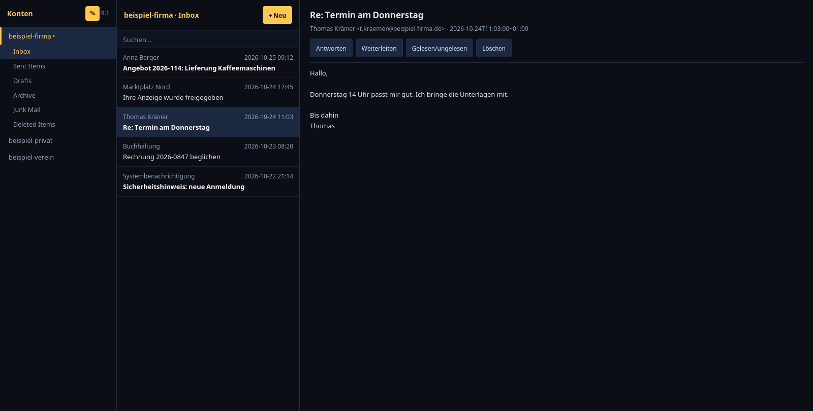

# Smartys Himalaya GUI



**Eine grafische Oberfläche für [himalaya](https://github.com/pimalaya/himalaya)** —
den Mail-Client fürs Terminal, der IMAP, SMTP, JMAP, Gmail, Microsoft Graph und
Maildir beherrscht.


---

## Warum es das gibt

himalaya ist bewusst nur eine Engine: *„a simple CLI API that can be used
directly from the terminal, from scripts, from UIs"*. Eine UI dazu existierte
nicht — das einzige `himalaya-gui` auf GitHub ist ein leeres
eframe-Template von 2023, zehn Tage nach dem Anlegen aufgegeben. Alles andere
sind Textoberflächen für Vim, Emacs oder das Terminal.

Dazu kommt ein Problem, an dem Thunderbird und Claws Mail scheitern: Sobald
mehrere Postfächer mit **unterschiedlichen Anmeldemethoden** zusammenkommen —
klassische Passwörter, App-Passwörter, OAuth2 — brauchen diese Clients die
Zugangsdaten im Klartext. himalaya holt sie zur Laufzeit aus seiner
Konfiguration. Diese Oberfläche nutzt genau das: **Sie spricht nie selbst mit
einem Mailserver.**

## Funktionen

- **Alle himalaya-Konten** in einer Oberfläche — auch mit gemischten
  Anmeldemethoden (Passwort, App-Passwort, OAuth2)
- **Ordner** je Konto: Eingang, Gesendet, Entwürfe, Papierkorb …
- **Nachrichten lesen** — HTML-Mails werden in lesbaren Text gewandelt,
  quoted-printable dekodiert, kein Tracking
- **Anhänge** herunterladen
- **Antworten und Weiterleiten** mit korrektem Threading
  (`In-Reply-To` / `References`)
- **Verfassen mit Formatierung**: fett, kursiv, unterstrichen,
  durchgestrichen, Schriftgröße, Schriftart, Schriftfarbe, Textmarker,
  Listen, Links
- **Signaturen je Kontogruppe** — eine Signatur für alle `firma-*`-Postfächer,
  Ausnahmen pro Konto möglich
- **Suche** über Betreff und Absender
- **Konten anlegen** direkt in der Oberfläche, mit Anbieter-Erkennung für
  Gmail, GMX, WEB.DE, T-Online, Outlook, Yahoo, IONOS, Posteo, Mailbox.org
- **Zwei Betriebsarten**: eigenes Fenster (GTK/WebKit) oder Web-Oberfläche

## Installation

### Debian / Ubuntu (empfohlen)

```bash
wget https://github.com/smartonaut/smartys-himalaya-gui/releases/latest/download/smartys-himalaya-gui_0.1.0_all.deb
sudo apt install ./smartys-himalaya-gui_0.1.0_all.deb
```

Danach:

- **Fenster-Variante**: `smartys-himalaya-gui` — oder im Anwendungsmenü
- **Web-Variante**: <http://127.0.0.1:8771> (startet automatisch mit)

Voraussetzung ist ein eingerichtetes himalaya. Fehlt es:

```bash
curl -sSL https://raw.githubusercontent.com/pimalaya/himalaya/master/install.sh | PREFIX=~/.local sh
```

Beim ersten Start führt die Oberfläche durch das Anlegen eines Kontos:
E-Mail-Adresse eingeben, Passwort eintragen — die Servereinstellungen werden
anhand der Domain erkannt. Für Gmail, Yahoo und Microsoft wird zusätzlich
erklärt, wo das nötige App-Passwort zu finden ist.

### Aus dem Quelltext

```bash
git clone https://github.com/smartonaut/smartys-himalaya-gui.git
cd smartys-himalaya-gui
python3 -m smartys_mail              # Web-Variante auf Port 8770
python3 -m smartys_mail.desktop      # Fenster-Variante (braucht GTK/WebKit)
```

Keine Abhängigkeiten außer Python 3.11+ (wegen `tomllib`). Die Fenster-Variante
braucht zusätzlich `python3-gi` und `gir1.2-webkit2-4.1`.

### Ohne echtes Postfach ausprobieren

```bash
SMARTYS_MAIL_DEMO=1 SMARTYS_MAIL_PORT=8774 python3 -m smartys_mail
```

Zeigt erfundene Beispielkonten — gut für Screenshots oder um sich die
Oberfläche anzusehen, bevor man Zugangsdaten einträgt.

## Paket selbst bauen

```bash
./packaging/build-deb.sh
# -> packaging/smartys-himalaya-gui_0.1.0_all.deb
```

## Konfiguration

### Konten

Werden in `~/.config/himalaya/config.toml` verwaltet — entweder über die
Oberfläche oder direkt. Diese Anwendung liest daraus nur die
Absenderadressen, **niemals Passwörter**. Neuanlagen erkennt sie nach einem
Neuladen automatisch.

### Signaturen

Liegen in `signaturen.json` neben dem Programm (Pfad über
`SMARTYS_MAIL_SIG` überschreibbar) und werden über das ✎-Symbol gepflegt:

```json
{
  "gruppen": {
    "firma": "<p><b>Vorname Nachname</b><br>firma.de</p>"
  },
  "ausnahmen": {
    "firma-chefin": "<p><b>Anderer Name</b></p>"
  }
}
```

Die Gruppe eines Kontos ist der Teil vor dem ersten Bindestrich:
`firma-buchhaltung` gehört zu `firma`.

### Umgebungsvariablen

| Variable | Bedeutung |
|---|---|
| `SMARTYS_MAIL_PORT` | Port (Standard 8770 Web, 8771 Paket) |
| `SMARTYS_MAIL_BIND` | Adresse (Standard `127.0.0.1`) |
| `SMARTYS_MAIL_DEMO` | `1` = Beispieldaten statt echter Postfächer |
| `SMARTYS_MAIL_SIG` | Pfad zur Signaturdatei |
| `SMARTYS_MAIL_HIMALAYA` | Pfad zur himalaya-Binary |

## Sicherheit

- Lauscht ausschließlich auf `127.0.0.1` — kein Zugriff aus dem Netz
- Kennt keine Passwörter; die Anmeldung erledigt himalaya
- HTML aus Mails wird **nicht** gerendert, sondern in Text gewandelt —
  Tracking-Pixel und eingebettete Skripte laufen ins Leere
- Beim Senden geht der Text als Argument an himalaya, nie durch eine Shell
- Die Konfigurationsdatei wird mit `0600` angelegt und vor Änderungen gesichert

## Grenzen

Ehrlich benannt, damit niemand Überraschungen erlebt:

- **Anhänge senden** fehlt noch (Empfangen und Herunterladen geht)
- **Entwürfe** werden nicht zwischengespeichert — ein geschlossener Tab
  verwirft den Text
- **Kein Push**: neue Mails erscheinen beim Neuladen, nicht von selbst
- **Kein Adressbuch, kein Kalender** — dafür gibt es `cardamum` und
  `calendula` aus derselben Schmiede

## Mitmachen

Fehler gefunden? [Issue aufmachen](https://github.com/smartonaut/smartys-himalaya-gui/issues).
Pull Requests willkommen — bitte ohne Zugangsdaten oder persönliche Daten
im Code.

## Weitere Projekte

- [Smartys IPTV](https://github.com/smartonaut/smartys-iptv-desktop) —
  Player für Live-TV, Filme und Serien (Kotlin, Compose Multiplatform)
- [Smartys Downloader](https://github.com/smartonaut/smartys-downloader) —
  Download-Manager mit Multi-Segment und Scheduler (Python/FastAPI)
- [Smartys CamViewer](https://github.com/smartonaut/smartys-camviewer) —
  Android-Kiosk für RTSP/ONVIF-Kameras
- [Profil](https://github.com/smartonaut)

## Lizenz

MIT — siehe [LICENSE](LICENSE).
